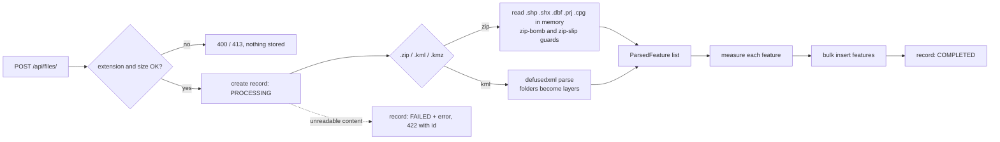

# Geospatial File Measurement API

A FastAPI service that accepts a **Shapefile (`.zip`)** or **KML** file, extracts every feature
(ID, geometry type, geometry, CRS, properties) and returns **CRS-aware measurements**:
**area** for polygons, **length** for lines, nothing for points.

Measurements are never computed in degrees. Geographic coordinates are projected to a suitable
metric CRS first, and every result carries an independent **ellipsoidal (geodesic) cross-check** so a
client can see exactly how trustworthy the number is.

- 157 automated tests; the CI workflow targets Python 3.11 – 3.13 (developed on 3.13)
- Handles hostile and messy input: zip bombs, zip-slip, XML entity attacks, corrupt files, invalid
  polygons, unsupported geometry types. One bad feature never fails a whole upload.
- Interactive docs at `/docs` (Swagger UI) and `/redoc`

---

## Quick start

### Local

```bash
python -m venv .venv && source .venv/bin/activate     # Python 3.11+
pip install -r requirements-dev.txt
uvicorn app.main:app --reload
```

Open <http://127.0.0.1:8000/docs>, or use the sample files:

```bash
curl -X POST http://127.0.0.1:8000/api/files/ -F "file=@sample_data/bengaluru_survey.kml"
curl http://127.0.0.1:8000/api/files/<id>/measurements/
```

### Docker

```bash
docker compose up --build        # API on http://localhost:8000, data kept in a named volume
```

### Tests and lint

```bash
pytest          # 157 tests, ~5 s
ruff check .
```

### Configuration (environment variables)

| Variable | Default | Meaning |
|---|---|---|
| `DATABASE_URL` | `sqlite:///./data/geo_measure.db` | Any SQLAlchemy URL (PostgreSQL works unchanged) |
| `MAX_UPLOAD_BYTES` | `52428800` (50 MB) | Largest accepted upload |
| `MAX_UNCOMPRESSED_BYTES` | `524288000` (500 MB) | Zip-bomb guard: total decompressed size |
| `MAX_ZIP_MEMBERS` | `1000` | Zip-bomb guard: number of archive members |
| `MAX_FEATURES` | `250000` | Features accepted from one file |
| `LOG_LEVEL` | `INFO` | Python log level |

---

## API

| Method | Path | Purpose |
|---|---|---|
| `POST` | `/api/files/` | Upload and process a `.zip` (Shapefile), `.kml` (or `.kmz`) |
| `GET` | `/api/files/{id}/` | File information |
| `GET` | `/api/files/{id}/measurements/` | Measurements for every feature, with totals |
| `GET` | `/api/files/{id}/features/` | Features with geometry, CRS, properties and measurements |
| `GET` | `/api/files/{id}/features/{index}/` | One feature |
| `GET` | `/api/files/` | List uploads (paged, filter by `status`) |
| `DELETE` | `/api/files/{id}/` | Delete a file and its features |
| `GET` | `/health` | Liveness |

Trailing slashes are optional. The first three rows are the required endpoints; the rest are extras.

### Upload

```bash
curl -X POST http://localhost:8000/api/files/ -F "file=@sample_data/bengaluru_survey.kml"
```

```json
{
  "id": "d76916bfdc7648cf99812990e60039cb",
  "filename": "bengaluru_survey.kml",
  "file_type": "kml",
  "size_bytes": 1711,
  "feature_count": 5,
  "crs": "EPSG:4326",
  "status": "COMPLETED",
  "geometry_types": { "Polygon": 2, "LineString": 1, "Point": 2 },
  "warnings": [],
  "error": null,
  "created_at": "2026-10-07T19:01:43.045122Z",
  "completed_at": "2026-10-07T19:01:43.053112Z"
}
```

`crs` is `MIXED` if layers inside one upload use different CRSs (each feature still reports its own).

### Measurements

`GET /api/files/{id}/measurements/?geometry_type=Polygon&status=MEASURED&limit=100&offset=0`

```json
{
  "file_id": "d76916bfdc7648cf99812990e60039cb",
  "filename": "bengaluru_survey.kml",
  "crs": "EPSG:4326",
  "units": { "area": "square metres", "length": "metres" },
  "summary": {
    "measured": 3, "not_applicable": 2, "unsupported": 0, "empty": 0, "errors": 0,
    "total_area_m2": 1240000.0024, "total_perimeter_m": 6400.0, "total_length_m": 2500.0
  },
  "total": 5, "limit": 1000, "offset": 0,
  "measurements": [
    {
      "index": 0,
      "source_id": "parcel-a",
      "layer": "Parcels",
      "geometry_type": "Polygon",
      "crs": "EPSG:4326",
      "status": "MEASURED",
      "area_m2": 999999.9999,
      "perimeter_m": 4000.0,
      "length_m": null,
      "method": {
        "strategy": "utm",
        "crs": "EPSG:32643",
        "geodesic_check": { "area_m2": 998895.4259, "perimeter_m": 3997.7902, "max_deviation_pct": 0.11058 }
      },
      "warnings": []
    }
  ]
}
```

Per-feature `status`:

| Status | Meaning |
|---|---|
| `MEASURED` | Area/perimeter (polygons) and/or length (lines) calculated |
| `NOT_APPLICABLE` | Valid geometry with nothing to measure (points) |
| `UNSUPPORTED` | Geometry kind we do not measure (KML `Model`, shapefile `MultiPatch`) |
| `EMPTY` | Null or empty geometry |
| `ERROR` | This one feature was broken (bad coordinates, untransformable CRS); the rest are unaffected |

`summary` totals the features matching the current filters, regardless of paging.

### Features

`GET /api/files/{id}/features/{index}/` returns the measurement fields plus the geometry and attributes:

```json
{
  "index": 0,
  "layer": "parcels_utm43",
  "geometry_type": "Polygon",
  "crs": "EPSG:32643",
  "status": "MEASURED",
  "area_m2": 1000000.0,
  "geometry": { "type": "Polygon", "coordinates": [[[777000.0, 1434000.0], "..."]] },
  "properties": { "name": "Block 1" }
}
```

`geometry` is GeoJSON in the feature's **own CRS** (the one in `crs`), with elevation dropped.

### Errors

Every error has the same shape: `{"detail": "...", "code": "...", "id": "<only when a FAILED record exists>"}`.

| HTTP | `code` | When |
|---|---|---|
| 400 | `UNSUPPORTED_FILE_TYPE`, `EMPTY_FILE` | Wrong extension or empty body (nothing is stored) |
| 404 | `NOT_FOUND` | Unknown file or feature |
| 409 | `FILE_PROCESSING_FAILED`, `FILE_NOT_READY` | Reading results of a failed or in-progress file |
| 413 | `FILE_TOO_LARGE` | Over `MAX_UPLOAD_BYTES` |
| 422 | `INVALID_KML`, `INVALID_ZIP`, `INVALID_SHAPEFILE`, `MISSING_CRS`, `UNSAFE_XML`, `TOO_MANY_FEATURES`, `VALIDATION_ERROR`, ... | Right extension but unusable content. A `FAILED` record is kept and its `id` is returned, so `GET /api/files/{id}/` explains what went wrong |

---

## Architecture

```
app/
  main.py                  app factory, error handlers, upload-size guard
  config.py                env-driven settings (all limits)
  api/files.py             HTTP layer only: validation, paging, response shaping
  api/schemas.py           Pydantic response models (drive the OpenAPI docs)
  services/ingest.py       orchestration: validate -> record -> parse -> measure -> persist
  services/parsers/        kml_parser.py, shapefile_parser.py -> ParsedDataset
  services/crs.py          CRS classification and projected-CRS selection
  services/measure.py      per-feature area / length + geodesic cross-check
  domain.py                plain dataclasses/enums shared by the layers (no web or DB imports)
  models.py, database.py   SQLAlchemy 2.0 models (UploadedFile 1-N Feature), engine setup
tests/                     157 tests; builders.py generates files with exactly known geometry
scripts/make_sample_data.py   regenerates sample_data/
```

The geospatial core (`parsers`, `crs`, `measure`) depends on neither FastAPI nor the database, so it
is unit-tested directly. The API tests then exercise everything through HTTP.

### File-processing flow



1. **Validate**: extension, non-empty, size (checked from `Content-Length` and again while reading).
2. **Parse**: ZIPs are read member by member into memory and never extracted to disk, so path
   traversal names cannot write anywhere. KML is parsed with `defusedxml` (no DTDs or entities). Each
   feature becomes a `ParsedFeature` with index, geometry, geometry type, CRS, properties, and its
   layer (shapefile name or KML folder path).
3. **Measure**: each feature is measured independently; problems become a `status` and `warnings`
   on that feature instead of an exception.
4. **Persist**: features are bulk-inserted; the file record flips to `COMPLETED`.

### CRS handling

KML is always WGS84 lon/lat by specification. Shapefiles declare their CRS in the `.prj` file
(ESRI or OGC WKT), read with `pyproj`. A shapefile with no `.prj` is accepted **only** if every
coordinate is a valid lon/lat pair (then EPSG:4326 is assumed, with a warning); otherwise it is
rejected with `MISSING_CRS` rather than measured wrongly.

The projected CRS is chosen **per feature**:

| Strategy | When | Area | Length / perimeter |
|---|---|---|---|
| `source_projected` | File CRS is projected, has a known linear unit, and is not Mercator-like | in the file's CRS (feet are converted to metres) | same |
| `utm` | Geographic input that fits in one 6° UTM zone between 80°S and 84°N | UTM zone from the feature's bounds centre (`EPSG:326xx` / `327xx`) | UTM |
| `ups` | Entirely in a polar cap | UPS (`EPSG:32661` / `32761`) | UPS |
| `equal_area_geodesic` | Wider than one UTM zone, or crossing the UTM latitude limits | Lambert azimuthal equal-area centred on the feature | WGS84 ellipsoid |

Web Mercator, plate carrée and similar projections badly distort area and length, so files in those
CRSs are re-projected to lon/lat and measured through the table above, never in their own units.

### Measurement flow

```
geometry (source CRS)
  -> drop Z, flatten Multi*/collections into Polygon / LineString / Point parts
  -> repair invalid polygons (shapely.make_valid) and record a warning
  -> choose projected CRS (table above)
  -> reproject and measure planar area, perimeter, length
  -> geodesic cross-check on the WGS84 ellipsoid (pyproj.Geod)
  -> warn if projected and geodesic values differ by more than 1 %
```

Polygons with holes subtract the holes; `MultiPolygon` and `MultiLineString` sum their parts;
`GeometryCollection` measures each member.

### Accuracy

Measured with the service on 0.01° × 0.01° squares versus the independent ellipsoidal calculation:

| Location | Strategy | Area (m²) | Geodesic (m²) | Difference |
|---|---|---|---|---|
| Quito (equator) | utm `EPSG:32617` | 1,232,293 | 1,230,907 | 0.113 % |
| Bengaluru | utm `EPSG:32643` | 1,201,684 | 1,200,290 | 0.116 % |
| London | utm `EPSG:32630` | 772,639 | 772,496 | 0.018 % |
| Sydney | utm `EPSG:32756` | 1,026,226 | 1,026,350 | 0.012 % |
| Tromsø (69.6°N) | utm `EPSG:32634` | 432,754 | 433,034 | 0.065 % |
| 6°E / 45°N (zone edge) | utm `EPSG:32632` | 876,663 | 876,163 | 0.057 % |

UTM is conformal, not equal-area; its scale factor ranges from 0.9996 to about 1.001 across a zone,
which is where the 0.01 – 0.12 % comes from. If you need the ellipsoidal value, it is in
`method.geodesic_check` on every measured feature.

---

## Design decisions and alternatives considered

| Decision | Why | Alternatives considered |
|---|---|---|
| **FastAPI** | Typed request/response models give validation and OpenAPI docs for free; sync endpoints run in a threadpool, which suits CPU-bound parsing | Django + DRF: heavier, and its ORM/admin add nothing here |
| **Pure-Python parsing: `pyshp` + `defusedxml` + `shapely` + `pyproj`** | `pip install` works everywhere with no GDAL system library, so the Docker image stays small and CI never fights native builds. Reading from memory also removes temp-file and path-traversal concerns | GeoPandas/Fiona/GDAL: more format coverage, but a heavy native dependency (the Fiona wheel I tried had no KML driver at all) |
| **UTM for small features, equal-area + ellipsoid for large** | UTM is what most GIS users expect and is accurate to ~0.1 %; a single projection cannot stay accurate over continents, so wide features switch method | One global equal-area CRS (EPSG:6933): exact area but distorts distance at high latitudes. Geodesic-only: exact, but not the "project first" approach the brief asks for |
| **Per-feature CRS selection** | One file can span several UTM zones; a file-level choice would distort the outliers | Single CRS per file: simpler, less accurate |
| **Geodesic cross-check on every result** | Makes accuracy visible and testable instead of asserted | Skip it: cheaper, but no way to detect bad data or a poor projection fit |
| **Measure at upload time and store results** | Reads are then simple indexed queries with filtering, paging and totals done in SQL | Measure on read: avoids storage, repeats CPU work for every request |
| **Synchronous processing** | Files are capped at 50 MB, parsing takes milliseconds to seconds, and the client gets the final result in one round trip | Background worker with `PROCESSING` status: see future scope |
| **SQLAlchemy + SQLite by default** | Zero setup locally, and a URL change moves it to PostgreSQL | In-memory dict: loses data on restart |
| **Failed uploads keep a `FAILED` record** | Gives the client an `id` and a stored reason, matching the `status` field in the brief | Reject without storing: simpler, but no audit trail |
| **Graceful per-feature failure** | A single `Model` placemark or corrupt shape should not discard 10,000 good features | Fail the whole upload |
| **Hard limits on size, members, decompressed bytes, features** | A public upload endpoint must survive zip bombs and giant inputs | Trust the client |

### Security and robustness

- Zip members are read in memory with a decompression budget, never extracted (no zip-slip).
- KML parsing with `defusedxml` rejects DTDs and entity expansion (XXE, billion laughs).
- Client filenames are reduced to their last path component.
- No stack traces leak: unexpected errors return a generic 500 and are logged server-side.
- The container runs as a non-root user.

### Known limitations

- Polygon edges are treated as straight lines in the projection, so a polygon with very long edges
  (hundreds of km) can differ from its geodesic reference; the service warns above 1 %. KML edges are
  nominally great-circle arcs, so this affects only continent-scale shapes.
- Shapefiles use the `.prj` as written; a wrong `.prj` gives wrong numbers (the lon/lat range check
  catches the common case of projected coordinates labelled geographic).
- Z values are ignored (plan-view area and length), so slope-corrected surface area is not computed.

---

## Learnings

- **"Never measure in degrees" is the easy half.** Choosing the projection matters just as much: UTM
  is conformal rather than equal-area, which is why the geodesic cross-check earned its place.
- **Test oracles must be independent.** The test builders draw shapes in UTM metres (a 1,000 m
  square must be 1,000,000 m²) and convert them to lon/lat, so expected values never come from the
  code under test.
- **Library details bite.** `pyproj.Geod` area for polygons with holes depends on ring orientation,
  so holes are subtracted explicitly; shapefile rings use clockwise-outer winding that differs from
  GeoJSON, so orientation cannot be trusted either way.
- **Treat uploads as hostile from the start.** Size, zip, XML and feature-count limits were cheap to
  add early and awkward to retrofit.
- **Degrade, don't fail.** Reporting `UNSUPPORTED`, `EMPTY` and `ERROR` per feature turned out to be
  more useful to API clients than a hard error.

## Future scope

- **Async processing**: upload returns `202` with `PROCESSING`; a worker (Celery, RQ or ARQ) processes
  large files and clients poll or receive a webhook (the `status` model already supports it).
- **Edge densification** (`shapely.segmentize`) before projecting, so very long polygon edges follow
  the intended great-circle or parallel paths.
- **More formats**: GeoJSON, GeoPackage, GPX, and a GDAL-backed reader behind the same
  `ParsedDataset` interface for formats `pyshp` cannot read.
- **Spatial database**: PostgreSQL + PostGIS for spatial queries (bbox, intersects) and
  `ST_Area(geography)` as a second cross-check.
- **Output options**: `?geometry_crs=EPSG:4326` to reproject returned geometry, `?units=ha|acre|km2`,
  and CSV/GeoJSON export of measurements.
- **Operations**: authentication and per-user quotas, rate limiting, object storage for the original
  upload, Alembic migrations, Prometheus metrics.
- **Surface area** using elevation when Z values are present.

---

## Sample data

`sample_data/` holds four files, generated by `scripts/make_sample_data.py` from geometry with exactly
known dimensions (so you can check the API's answers by hand):

| File | Contents | Expected |
|---|---|---|
| `bengaluru_survey.kml` | Folders with a 1 km² parcel, a 500 m parcel with a 100 m courtyard, a road, two points | 1,000,000 m² + 240,000 m²; road 2,500 m |
| `edge_cases.kml` | Valid square, self-intersecting bow-tie, 3D `Model`, empty placemark, bad coordinates | 2 measured (bow-tie repaired to 5,000 m²), 1 unsupported, 1 empty, 1 error |
| `parcels_utm43.zip` | Shapefile already in `EPSG:32643` | 1,000,000 m² and 40,000 m², measured in place |
| `districts_wgs84.zip` | Shapefile in `EPSG:4326` | 4,000,000 m² |

## License

MIT
